  
  
  
  

I'm a Computer Programming student at Ondokuz Mayıs University in Samsun, Türkiye. I build tools with clear boundaries and reproducible output, and I ship them: packages on **crates.io, npm and PyPI**, and fixes merged into **cargo-deny, gosec, conftest** and others.

AI agents help me move faster. Tests, review and runtime evidence decide what ships.

---

## Now building

<table>
  <tr>
    <td width="50%" valign="top">
      <h3>A Rust game engine with an AI-native editor</h3>
      The editor exposes an <strong>MCP</strong> server, so AI agents work inside it under clear roles:
      they observe the scene, propose changes and run tests, and every change goes through one command bus
      that can be undone, audited and replayed.
        
      <code>Rust</code> <code>wgpu</code> <code>MCP</code> <code>deterministic simulation</code>
    </td>
    <td width="50%" valign="top">
      <h3>Interactive live-stream games</h3>
      Small games that viewers control during a live stream, built on the engine's 2D core and compiled to
      <strong>WebAssembly</strong>. They are the engine's first real users.
        
      <code>Rust</code> <code>WASM</code> <code>2D</code> <code>live streaming</code>
    </td>
  </tr>
</table>

Both are early and private for now. Progress will be shared here as it lands.

---

## Featured projects

<table>
  <tr>
    <td width="50%" valign="top">
      <h3><a href="https://github.com/SetraTheXX/Portal-Doctor">PortalDoctor</a></h3>
      
      
        
      A read-only Linux diagnostic tool for XDG Desktop Portal, Wayland, D-Bus, systemd, PipeWire and
      WirePlumber failures. It explains the routing path instead of asking users to guess.
        
      <strong>Release:</strong> <a href="https://github.com/SetraTheXX/Portal-Doctor/releases/tag/v0.2.1"><code>v0.2.1</code></a> · Linux x86_64 binary 
      <strong>Demo:</strong> <a href="https://github.com/SetraTheXX/Portal-Doctor/blob/v0.2.1/docs/assets/portaldoctor-demo.gif">terminal flow</a> · JSON + Markdown reports 
      <strong>Boundary:</strong> the published release is passive and read-only.
        
      <code>Rust 2024</code> <code>Linux diagnostics</code> <code>read-only</code>
    </td>
    <td width="50%" valign="top">
      <h3><a href="https://github.com/SetraTheXX/next-secure-check">next-secure-check</a></h3>
      
      
      
        
      A deterministic security baseline for AI-generated and human-written Next.js code. It checks common
      auth, injection, secrets and configuration risks.
        
      <strong>Release:</strong> <a href="https://github.com/SetraTheXX/next-secure-check/releases/tag/v0.6.1"><code>v0.6.1</code></a> · 25 rules · 643 tests in release CI 
      <strong>Try:</strong> <code>npx --yes next-secure-check@0.6.1 scan . --preset app --summary</code> 
      <strong>Integrations:</strong> SARIF · GitHub Action 
      <strong>Boundary:</strong> findings are review signals, not confirmed vulnerabilities.
        
      <code>TypeScript</code> <code>AST-assisted</code> <code>bounded flow</code>
    </td>
  </tr>
  <tr>
    <td width="50%" valign="top">
      <h3><a href="https://github.com/SetraTheXX/pagonic">Pagonic</a></h3>
      
        
      Inspect ZIP archives before extraction. Pagonic detects path traversal, suspicious entries,
      extreme compression ratios, unsupported methods and structural errors before any file is written.
        
      <strong>Release:</strong> <a href="https://github.com/SetraTheXX/pagonic/releases/tag/v0.5.2"><code>v0.5.2</code></a> · wheel + sdist 
      <strong>Flow:</strong> <code>inspect</code> → <code>verify</code> → <code>safe-extract</code> 
      <strong>Output:</strong> deterministic reports · policy gates · JSON + Markdown
        
      <code>Python</code> <code>CLI</code> <code>safe extraction</code>
    </td>
    <td width="50%" valign="top">
      <h3><a href="https://github.com/SetraTheXX/Codex-Engineering-Workflow-Pack">Codex Engineering Workflow Pack</a></h3>
      
        
      A local-first control plane around Codex: approve scope, execute in an isolated worktree, verify
      outside the model loop, require independent review and leave a portable receipt.
        
      <strong>Release:</strong> <a href="https://github.com/SetraTheXX/Codex-Engineering-Workflow-Pack/releases/tag/v0.14.0"><code>v0.14.0</code></a> · npm stable 
      <strong>Flow:</strong> <code>plan</code> → <code>approve</code> → <code>execute</code> → <code>verify</code> → <code>review</code> → <code>receipt</code>
        
      <code>Node.js 22+</code> <code>Codex plugin</code> <code>local MCP</code>
    </td>
  </tr>
</table>

---

## Merged open-source contributions

Narrow, reviewable fixes with regression coverage, merged upstream.

| Project | Pull request | Focus |
| --- | --- | --- |
| **cargo-deny** | [#893](https://github.com/EmbarkStudios/cargo-deny/pull/893) | Sparse registry matching for literal IP hosts |
| **gosec** | [#1733](https://github.com/securego/gosec/pull/1733) | Deterministic, bounded taint caller traversal |
| **conftest** | [#1413](https://github.com/open-policy-agent/conftest/pull/1413) | Apply `--ignore` to explicitly provided files |
| **OWASP Noir** | [#2657](https://github.com/owasp-noir/noir/pull/2657) | Functional coverage for the Vercel specification analyzer |
| **Ship Safe** | [#161](https://github.com/asamassekou10/ship-safe/pull/161) | MCP/OAuth security checks |
| **codex-with-chatgpt** | [#26](https://github.com/XiaoDuoYa/codex-with-chatgpt/pull/26) | OAuth pairing-page HTML hardening and browser security headers |

---

## Private work

Larger systems that stay private while research and review continue.

| Project | Focus |
| --- | --- |
| **RedNode** | Local-first security workstation for authorized engagements: explicit scope, typed execution, evidence and verification boundaries. |
| **HuntForge** | Bug-bounty web/API security workspace: scope, approvals, bounded validation, evidence, triage, retesting and reporting. |
| **BorsaLab** | Local-first BIST research workstation: explainable screening, reproducible backtesting, portfolio discipline and fundamental analysis. |
| **BioVoid** | Computational research prototype for reproducible protein-structure analysis and geometry-based pocket-candidate generation. |

<strong>BioVoid scientific boundary</strong>

 
BioVoid produces unvalidated geometry-based pocket candidates and diagnostics. Its outputs are not clinical or diagnostic results, validated binding predictions, or drug-discovery claims.

### Also

[**Nihongo Learn**](https://github.com/SetraTheXX/nihongo-learn): Japanese learning for Turkish-speaking beginners, with kana practice, SM-2 reviews, 31 lessons, mini stories and N5-style practice.

---

## Toolbox

<picture>
  <source media="(prefers-color-scheme: dark)" srcset="https://skillicons.dev/icons?i=rust%2Cwasm%2Cts%2Cpy%2Cgo%2Cdart&theme=dark&perline=6" />
  <source media="(prefers-color-scheme: light)" srcset="https://skillicons.dev/icons?i=rust%2Cwasm%2Cts%2Cpy%2Cgo%2Cdart&theme=light&perline=6" />
  
</picture>
 
<picture>
  <source media="(prefers-color-scheme: dark)" srcset="https://skillicons.dev/icons?i=nodejs%2Cnextjs%2Creact%2Ctauri%2Cfastapi%2Cflutter%2Csqlite&theme=dark&perline=7" />
  <source media="(prefers-color-scheme: light)" srcset="https://skillicons.dev/icons?i=nodejs%2Cnextjs%2Creact%2Ctauri%2Cfastapi%2Cflutter%2Csqlite&theme=light&perline=7" />
  
</picture>
 
<picture>
  <source media="(prefers-color-scheme: dark)" srcset="https://skillicons.dev/icons?i=git%2Cgithubactions%2Cdocker%2Clinux&theme=dark&perline=4" />
  <source media="(prefers-color-scheme: light)" srcset="https://skillicons.dev/icons?i=git%2Cgithubactions%2Cdocker%2Clinux&theme=light&perline=4" />
  
</picture>

---

Open to open-source collaboration, Rust and game-engine discussions, developer tooling and selected freelance work.

<a href="https://linkedin.com/in/tuncayolmez"><strong>Reach me on LinkedIn →</strong></a>

